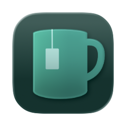

  

# BreakTimer-new

BreakTimer-new 是一款 Windows 桌面休息提醒应用。你可以设置工作与休息时长，
选择全屏休息窗口或系统通知，并让提醒只在需要的时间段内生效。

当前发布版本支持 **Windows 10 / 11（x64）**。

## 下载与安装

前往 [GitHub Releases](https://github.com/githunhunhub/breaktimer-new/releases)
下载最新版本。Gitee 仓库仅作为代码备份，不提供正式发布产物。

| 版本                       | 适用场景                       | 使用方式                                  |
| -------------------------- | ------------------------------ | ----------------------------------------- |
| 安装版（`*-setup.exe`）    | 日常安装使用                   | 运行安装程序，按提示完成安装              |
| 便携版（`*-portable.zip`） | 不想安装，或希望随目录携带数据 | 解压到可写目录，运行 `breaktimer-new.exe` |

安装版默认按当前用户安装，通常不需要管理员权限。应用和安装包当前没有代码签名，
Windows SmartScreen 可能显示安全提示；如需继续，请选择“更多信息”，确认文件来自
本项目的 [GitHub Releases](https://github.com/githunhunhub/breaktimer-new/releases)
后再选择“仍要运行”。

### 便携版说明

- 请保持 `BreakTimer-new` 文件夹完整，不要只移动可执行文件。
- 设置和运行数据保存在程序目录的 `data\` 中，可随文件夹一起移动。
- 删除 `data\` 会清除便携版设置并恢复首次运行状态。
- 如果移动了便携版目录，需要关闭并重新开启“登录时启动”，以更新启动路径。

## 主要功能

- 自定义休息频率、休息时长和工作时段。
- 使用全屏休息窗口，或仅发送系统通知。
- 支持推迟、跳过、立即休息，以及临时关闭休息提醒。
- 长时间离开电脑后可重置计时，减少无效提醒。
- 托盘菜单显示休息状态和倒计时。
- 支持开机启动、提示音、主题与遮罩设置。
- 支持简体中文和英语，也可跟随系统语言。

## 快速开始

1. 安装或解压并运行 BreakTimer-new。
2. 从系统托盘打开 **Settings**。
3. 设置休息频率、时长和提醒方式，并按需配置工作时段。
4. 点击 **Save** 保存设置。
5. 关闭设置窗口后应用仍会在托盘中运行。

日常操作可从托盘菜单完成，包括立即休息、暂停提醒、打开设置和退出应用。

## 系统要求

- Windows 10 或 Windows 11，64 位。
- Microsoft Edge WebView2 Runtime。当前 Windows 通常已自带；如果应用无法启动，
  可从 Microsoft 官网安装 WebView2 Runtime 后重试。

## 常见问题

### 关闭设置窗口后，为什么找不到应用？

关闭设置窗口只会将窗口隐藏到系统托盘，应用仍在后台计时。点击任务栏通知区域中的
BreakTimer-new 图标，即可打开设置或执行托盘菜单操作。

### 为什么没有收到系统通知？

请检查 Windows 的通知权限，并确认“专注助手”或“请勿打扰”没有屏蔽通知。也可以先在
设置中切换到全屏休息窗口，确认休息计划本身是否正常触发。

### 安装版的数据保存在哪里？

安装版设置保存在
`%APPDATA%\com.githunhunhub.breaktimernew\settings.json`。卸载应用后如需彻底清理，
可在确认不再需要设置后删除该目录。

### 这个版本会继承旧版 BreakTimer 的设置吗？

不会。BreakTimer-new 是独立的桌面应用，不读取、迁移或修改旧版 BreakTimer 的设置。
两者使用不同的应用身份，可以同时安装。

### 是否支持 macOS 或 Linux？

当前发布版本仅支持 Windows。macOS 和 Linux 不在当前发布范围内。

## 开发与维护

BreakTimer-new 采用文档先行的开发方式。项目结构、开发命令、文档入口和跨设备同步
约定见 [DEVELOPMENT.md](DEVELOPMENT.md)。

本项目源自 [tom-james-watson/breaktimer-app](https://github.com/tom-james-watson/breaktimer-app)，
当前使用 Tauri v2、Rust、React 和 TypeScript 独立重写。
